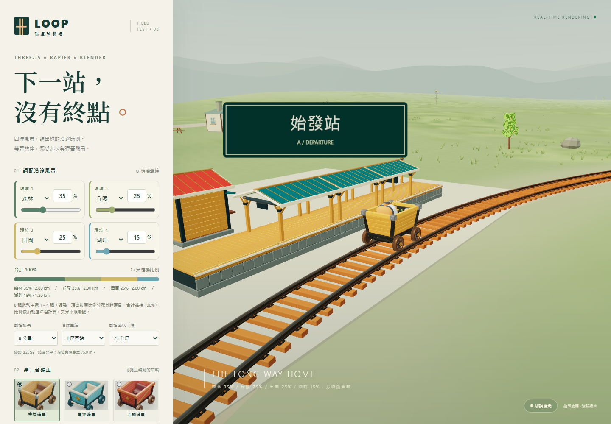
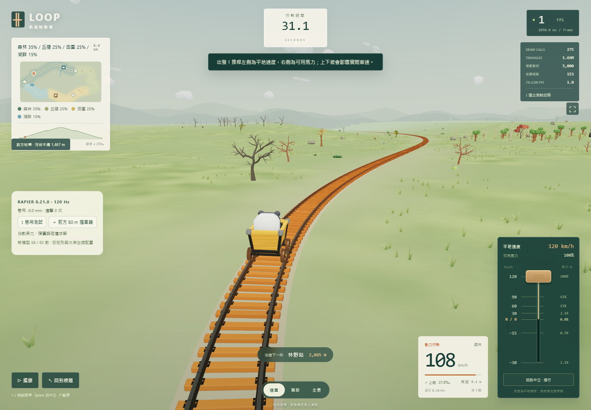
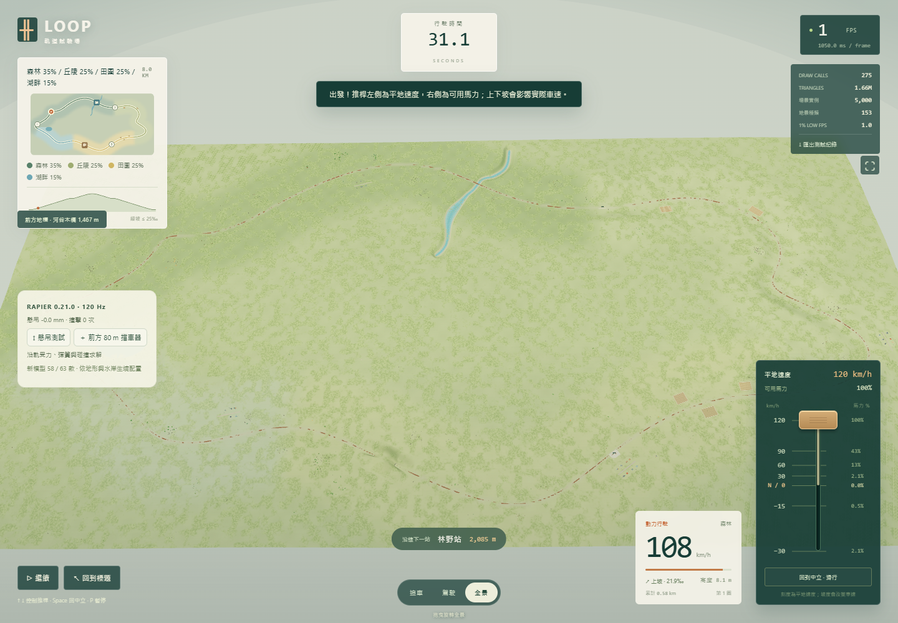
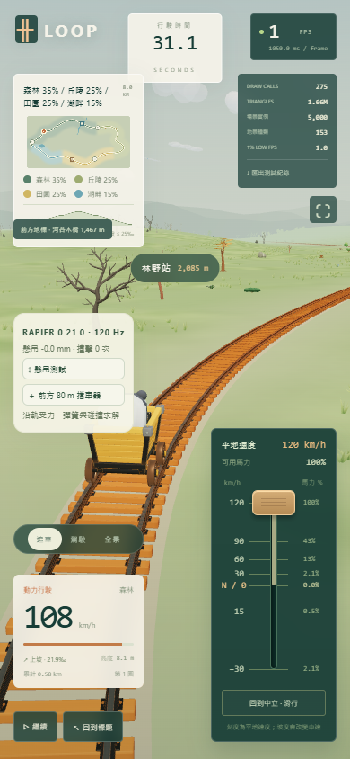

# v8.0.0 驗證紀錄

驗證日期：2026-11-12（Asia/Taipei）。這份文件對應本次 ZIP，舊的帶版本紀錄仍保留為歷史證據。

## 自動測試

`node scripts/verify-v8.mjs`：**80／80 通過、0 失敗**。測試期間原始碼未改變；937 個程式／測試／本機資產檔案的整體 SHA-256：

`0f47392762a16f8466867fdb584469067e50756583c10927b42b7b3c6b12ad91`

涵蓋全部八種地形、70 種四地形組合的路程配額、閉合交界、近軌空間權重、配比驗證及自動補齊、279 個主模型與 144 個 LOD、所有本機圖片引用、共享貼圖色彩空間、334 個原有 GLB 保留、軌道長度／坡度／橋隧、田區與軌道淨空、24 種動物、輪組與懸吊位置，以及 Rapier 的實際受力、限速、倒數、反向煞車、CCD 撞擊、彈簧回穩、十億公尺起點座標重定基準及釋放生命週期。

測試摘要為 `validation/automated-v8.json`，完整輸出為 `validation/test-v8.log`。334 個舊 GLB 另外逐一與使用者的原 v7 ZIP 比較，全部逐位元相同，明細為 `validation/v7-assets-preserved.json`。

## 新模型與生境

`validation/nature-v8-assets.json`：63 個主 GLB、457 個 accessor 有效資料、126 個外部圖片引用、18 張 PNG 解碼與 CRC、91 個材質的語意及原有變換皆通過。`validation/nature-v8-lod.json`：26 個 LOD 的完整葉片島嶼、材質、UV／法線與原始界限通過。

`validation/biome-v8-coverage.json`：三個代表場景合計使用全部 63 款；森林 50%／沙漠 50%、種子 V8-HABITATS-0 的單一場景也放入全部 63 款。並非只把檔案放進清單。

`validation/mix-v8-stress.json`：八種單一地形各生成 1,000 個物件；另外兩組 5 km 的四地形場景各生成 50,000 個物件，其中一組是沙漠 97%／雪地 1%／火山 1%／森林 1%。所有案例保留相容性及完整軌道淨空。

## 瀏覽器整合

Chrome 157.0.8103.52，桌面 1440×1000、手機直向 390×844。實際 HTTP 200；外部網路請求全部封鎖，無需 CDN 或額外 WASM 下載。沒有 JavaScript 例外、HTTP 錯誤或外部請求。

確認手動百分比、自動總和、兩種隨機模式、正式生成、63 款使用、650 kg 實際剛體質量、Rapier 求解步數與座標重定基準、懸吊衝量、80 m 擋車器撞擊與自動中立、移除擋車器、暫停、JSON 匯出、回標題釋放，以及手機面板位置。主要碰撞場景實際累計 22,602 個 Rapier 物理步。四地形 5,000 物件場景另外確認追車／全景與手機遊戲面板互不重疊。

數值長途測試用本機 `?qa=1` 的固定步加速驗證，執行與正式 requestAnimationFrame 相同的步進函式；部分截圖是在暫停並隱藏暫停提示的狀態取得。這是功能與渲染檢查，畫面上的 FPS 受自動化、截圖及一次推進多個物理秒影響，**不能當作一般裝置效能基準或 FPS 保證**。正式遊玩仍以正常牆鐘時間逐幀行駛。

紀錄為 `validation/browser-v8.json`、`validation/browser-four-biomes-v8.json`，實際匯出範例為 `validation/gameplay-v8-report.json`。

## 實際畫面

## 範圍

Rapier 是受軌道約束的行車與懸吊／碰撞求解，沒有完整三維輪緣接觸或脫軌；樹木／岩石為沿線景物，不是每件都建立動態剛體。原八地形比例已完成，未來四種地形仍在規劃。50,000 物件是壓力測試設定，實際流暢度須依裝置調整。

本次沒有發布網站、變更遠端倉庫或改寫 GameAssets 原始模型。ZIP 內有本機啟動器、完整程式、本機依賴、模型／貼圖、來源／授權、詳細說明及校驗。每個封裝檔案的 SHA-256 見 `CHECKSUMS.sha256`；ZIP 自身的 SHA-256 保留於壓縮檔旁，避免自我參照。
